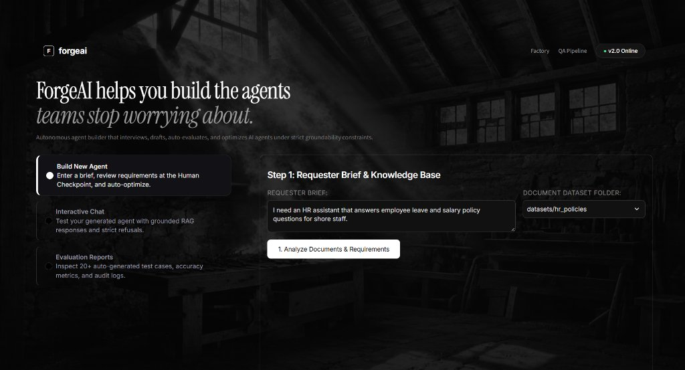
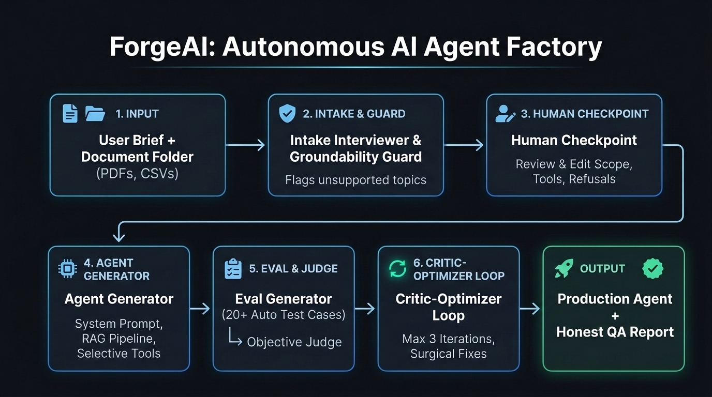

# ForgeAI: The Agent That Builds Agents

**Live Demo:** https://forge-ai-v5kapbchk2c6skg3ppudms.streamlit.app/



ForgeAI is an autonomous AI agent factory that takes a user brief and a corpus of internal documents, and autonomously produces a fully configured, tested, and optimized production agent. Rather than manually hand-crafting prompts and configurations, ForgeAI acts as an automated engineering pipeline that interviews the requester, drafts declarative agent specifications, generates synthetic test suites, evaluates performance, and applies iterative surgical optimizations.

---

## Architecture and Workflow



ForgeAI operates on the principle of automated agent engineering:

```
User Brief + Document Folder
             |
             v
+--------------------------------------------------------+
| 1. Requirements Interviewer & Groundability Guard      |
|    - Scans document corpus for supported topics        |
|    - Flags unsupported claims prior to prompt drafting |
|    - Produces structured scope, tone & refusal rules   |
+---------------------------+----------------------------+
                            |
                            v
+--------------------------------------------------------+
| 2. Declarative Agent Generator                         |
|    - Synthesizes grounded system prompts               |
|    - Calibrates retrieval parameters (top_k, chunking) |
|    - Attaches only tools the specific brief requires   |
|    - Defines structured output contracts               |
+---------------------------+----------------------------+
                            |
                            v
+--------------------------------------------------------+
| 3. Automated Evaluation Generator                      |
|    - Auto-generates 20+ test cases per domain          |
|    - Spans answerable, refusal, and multi-doc cases    |
+---------------------------+----------------------------+
                            |
                            v
+--------------------------------------------------------+
| 4. Judge & Critic-Optimizer Loop (Max 3 Iterations)    |
|    - Scores Grounding, Correctness, and Refusals       |
|    - Categorizes failures: Retrieval Miss, Prompt      |
|      Defect, Hallucination, or False Refusal           |
|    - Applies surgical targeted parameter/prompt fixes  |
+---------------------------+----------------------------+
                            |
                            v
+--------------------------------------------------------+
| 5. Runnable Product & Honest Reporting                 |
|    - Generic Chat Runner (CLI and Streamlit UI)        |
|    - Comprehensive markdown audit logs & scorecards    |
+--------------------------------------------------------+
```

---

## Project Structure

```
ForgeAI/
|
|-- datasets/
|   |-- hr_policies/             # Employee handbooks & compensation policies
|   `-- procurement/             # Spare parts catalogs & procurement guidelines
|
|-- src/
|   |-- __init__.py
|   |-- document_loader.py       # PDF/CSV extractor and text chunking
|   |-- requirements.py          # Clarifying interview and Groundability Guard
|   |-- agent_generator.py       # Declarative prompt and tool selection engine
|   |-- rag_pipeline.py          # TF-IDF cosine similarity vector retrieval
|   |-- tool_registry.py         # CSV lookup, Calculator, Date, and Weather tools
|   |-- eval_generator.py        # Automated test case generation engine
|   |-- judge.py                 # Multi-metric scoring and bias mitigation
|   |-- optimizer.py             # Multi-iteration Critic-Optimizer loop
|   |-- report_generator.py      # Markdown audit report and scorecard exporter
|   `-- llm_client.py            # Local Ollama, Gemini, or fallback runtime
|
|-- demos/
|   |-- hr_agent/                # Generated HR agent artifacts and logs
|   `-- procurement_agent/       # Generated Procurement agent artifacts and logs
|
|-- tests/
|   `-- test_forgeai.py          # End-to-end pytest verification suite
|
|-- app.py                       # Streamlit web interface (Factory, Chat, Reports)
|-- chat_runner.py               # Generic CLI chat execution interface
|-- run_demos.py                 # Automated execution script for all test agents
|-- requirements.txt             # Project dependencies
|-- pytest.ini                   # Test path configuration
`-- README.md                    # Technical documentation
```

---

## System Capabilities

### 1. Requirements Interviewer and Groundability Guard
- Formulates up to 5 clarifying questions to define scope, audience, tone, and operational boundaries.
- Inspects uploaded document text prior to agent generation.
- Identifies and flags unsupported requests (such as seafaring crew policies or cryptocurrency payroll) to prevent generating an agent that hallucinates gaps away.

### 2. Declarative Agent Generator and Selective Tool Attachment
- Produces a declarative JSON specification containing system prompts, retrieval parameters, and output contracts.
- Selects tools with strict domain constraints: only tools genuinely required by the brief are attached (e.g. an HR policy assistant is equipped with calculation and date tools, but explicitly excludes weather tools).

### 3. Automated Evaluation Generator
- Generates 20+ comprehensive evaluation cases directly from the source corpus without manual authoring.
- Balances test distributions across:
  - In-scope answerable questions with required source citations.
  - Out-of-scope queries that must be strictly refused.
  - Edge cases involving ambiguous phrasing or multi-document synthesis.

### 4. Objective Scoring Judge
- Evaluates Grounding, Factual Correctness, and Refusal Adherence.
- Enforces mitigations against LLM-as-judge failure modes including position bias, self-preference, and verbosity bias.

### 5. Critic-Optimizer Loop
- Executes test suites over up to 3 iterative passes.
- Diagnoses failed cases into structured root causes: `retrieval miss`, `prompt defect`, `hallucination / missing refusal`, or `wrong refusal`.
- Applies surgical targeted modifications to retrieval settings or prompt guardrails rather than blind regeneration, logging performance before and after every modification.

### 6. Honest Quality Reporting
- Automatically compiles comprehensive markdown audit reports and JSON scorecards.
- Explicitly documents remaining failure cases, root causes, and boundary conditions.

---

## Installation and Quickstart

### 1. Setup Environment
Ensure Python 3.10+ is installed:
```powershell
python --version
pip install -r requirements.txt
```

### 2. Run Test Suite
Validate all pipeline components:
```powershell
pytest -v
```

### 3. Run Agent Factory Demonstrations
Execute the automated build, test, and optimization cycles for both demonstration domains:
```powershell
python run_demos.py
```

### 4. Interactive Command-Line Chat Runner
Interact directly with any generated agent definition:
```powershell
# HR Agent
python chat_runner.py --agent demos/hr_agent/agent_definition.json --data datasets/hr_policies

# Procurement Agent
python chat_runner.py --agent demos/procurement_agent/agent_definition.json --data datasets/procurement
```

### 5. Launch Web Interface
Launch the Streamlit dashboard for interactive agent generation, chat, and evaluation review:
```powershell
streamlit run app.py
```

---

## Demonstration Summary

### HR Policy Assistant
- Brief: Assistant answering employee leave, attendance, and salary policy questions.
- Attached Tools: `calculator`, `current_date`
- Test Suite: 21 evaluation cases
- Pass Rate: 85.7% (18/21 passed, 0.840 composite score)
- Artifacts: Saved in `demos/hr_agent/`

### Ship-Spares Procurement Assistant
- Brief: Assistant for spare parts catalog lookups, supplier terms, and purchase order limits.
- Attached Tools: `csv_lookup`, `calculator`
- Test Suite: 21 evaluation cases
- Pass Rate: 71.4% (15/21 passed, 0.839 composite score)
- Artifacts: Saved in `demos/procurement_agent/`

---

## Human Checkpoint Input Examples

When reviewing or editing requirements at **Step 2: Human Checkpoint**, you can use these examples:

### HR Agent (`datasets/hr_policies`)
- **Allowed Topics (comma-separated):**
  `annual leave, sick leave, shore staff salary, notice period, benefits, workplace policies`
- **Out-of-Scope / Refusal Topics (comma-separated):**
  `seafarer crew salary, vessel crew contracts, bitcoin, stock options, personal tax advice`

### Procurement Agent (`datasets/procurement`)
- **Allowed Topics (comma-separated):**
  `spares catalogue, unit pricing, lead times, PO sign-off thresholds, AOG sourcing, vessel compatibility`
- **Out-of-Scope / Refusal Topics (comma-separated):**
  `imitation spares, Alibaba sourcing, bunker fuel prices, unapproved vendors`

---

## Sample Questions for Interactive Chat

You can test the generated agents in the **Interactive Chat Runner** tab or via `chat_runner.py` using these sample queries:

### HR Agent (`demos/hr_agent/agent_definition.json`)
- **Answerable:**
  - `How many days of annual leave do shore staff get?`
  - `What is the sick leave or medical leave policy?`
  - `What is the notice period for resignation?`
  - `How is shore staff salary and compensation structured?`
- **Out-of-Scope (Refusal Guardrail):**
  - `What is the salary of seafarer vessel crew?`
  - `Can I get paid in Bitcoin or stock options?`

### Procurement Agent (`demos/procurement_agent/agent_definition.json`)
- **Answerable:**
  - `What is the unit price and lead time for part P-101?`
  - `What are the purchase order sign-off thresholds?`
  - `What is the emergency AOG sourcing protocol?`
  - `Which vessels are compatible with part P-102?`
- **Out-of-Scope (Refusal Guardrail):**
  - `Can we buy imitation spares from Alibaba without obtaining quotes?`
  - `What is the current bunker fuel price?`
